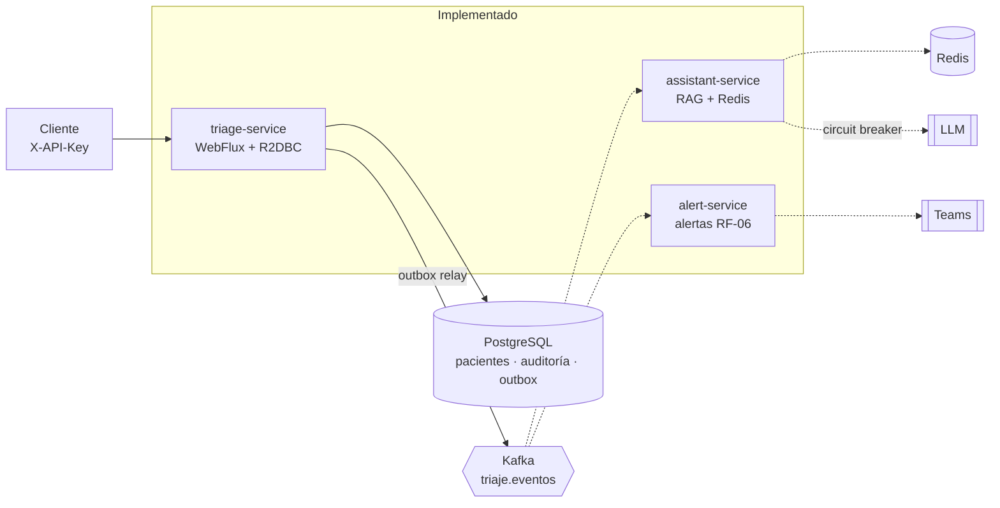

# VidaCruz — Sistema de Triaje Digital

Backend reactivo (Java 21, Spring Boot 3.5, WebFlux, R2DBC, Kafka) para el triaje de urgencias de VidaCruz: registra pacientes, los clasifica con reglas clínicas objetivas, controla los tiempos de atención (SLA), escala automáticamente a quienes los superan y deja auditoría clínica completa. Un segundo servicio ofrece un asistente clínico con RAG que solo responde con contenido de los protocolos oficiales.

> Prueba técnica "Dev. WebFlux" (nivel Senior / Arquitecto). Las decisiones de diseño están en los [ADR](docs/adr/README.md).

## Estado

| Requisito | Descripción | Estado |
|-----------|-------------|--------|
| RF-01 | Registro y clasificación automática (`POST /triage/pacientes`) | Implementado |
| RF-02 | Flujo de estados y consulta (`PATCH .../estado`, `GET .../{id}`) | Implementado |
| RF-03 | Monitoreo de SLA y escalamiento automático | Implementado |
| RF-05 | Reporte de operación por hora (SQL avanzado, [ADR-0011](docs/adr/0011-reporte-operacion-rf05.md)) | Implementado; `ReporteOperacionIT` verificado contra PostgreSQL 16 |
| RF-04 | Asistente clínico con RAG y estado de urgencias en tiempo real | Implementado (`assistant-service`). ITs con Redis, HTTP y consumidor de Kafka verificados con Podman. En AKS, la vista de urgencias se alimenta de Kafka (verificado). Las respuestas con LLM real dependen de OpenRouter (ver Limitaciones) |
| RF-06 | Alertas de escalamiento al equipo médico | Implementado (`alert-service`): webhook de Teams con respaldo en log y DLT (ADR-0007). Consumidor de Kafka verificado en AKS con alerta en el log de respaldo; webhook de Teams real sin verificar. El evento `paciente_escalado` lleva SLA y fecha de registro (contrato version 2) |
| — | Manifests de Kubernetes y despliegue en Azure | Implementado y desplegado en AKS ([ADR-0012](docs/adr/0012-servicios-de-datos-en-el-cluster.md)); ver [Despliegue en Azure](#despliegue-en-azure) |

Los tres servicios y el módulo `events-contract` están en el repositorio. El `docker-compose.yml` levanta toda la plataforma en local.

## Requisitos

- Java 21
- Docker, o Podman para las pruebas de integración (Testcontainers). Con Podman, expón su API compatible con Docker y apunta `DOCKER_HOST` a ella.
- Maven Wrapper: hoy está en `services/triage-service/mvnw`. La raíz del repositorio aún no tiene `mvnw` (ver Limitaciones).

## Ejecución local

```bash
cp .env.example .env          # completa DB_PASSWORD y API_KEY
docker compose -f deploy/docker/docker-compose.yml --env-file .env up --build
```

Levanta PostgreSQL, Kafka (modo KRaft), la creación de los topics, Redis y los tres servicios: triaje en `http://localhost:8081`, asistente en `8082` y alertas en `8083`. Flyway crea el esquema al arrancar. Para levantar solo el triaje, indica los servicios al final del comando: `postgres kafka kafka-init redis triage-service`.

### Variables de entorno

| Variable | Obligatoria | Descripción |
|----------|:-----------:|-------------|
| `DB_PASSWORD` | Sí | Contraseña de PostgreSQL |
| `DB_USER` | No | Usuario de PostgreSQL (por defecto `triage`) |
| `API_KEY` | Sí | Clave que deben enviar los clientes en `X-API-Key` |
| `TRIAGE_SLA_EVALUATION_INTERVAL` | No | Cada cuánto evalúa el monitor de SLA (por defecto `30s`) |
| `TRIAGE_SLA_MONITOR_ENABLED` | No | `false` apaga el scheduler (por defecto `true`) |
| `LLM_API_KEY` | Con el asistente | Clave del proveedor de LLM. Nunca se versiona |
| `TEAMS_WEBHOOK_URL` | Con alertas | Webhook de Teams. Vacío: solo registro en log |
| `DISCORD_WEBHOOK_URL` | Con alertas | Webhook de Discord (opcional). Vacío: solo registro en log |

Los SLA por nivel están en `services/triage-service/src/main/resources/application.yml` (`triage.sla.minutos`).

## Probar la API

Todos los endpoints exigen `X-API-Key`, salvo los probes `/actuator/health/**`.

```bash
export API_KEY=la-clave-de-tu-.env

# RF-01: paciente de ejemplo E1 → nivel CRITICO, SLA de 5 minutos
curl -s -X POST http://localhost:8081/triage/pacientes \
  -H "X-API-Key: $API_KEY" -H "Content-Type: application/json" \
  -d '{"nombreCompleto":"Carlos Gómez","edad":55,"frecuenciaCardiaca":130,
       "presionSistolica":180,"presionDiastolica":110,"spo2":97,
       "temperatura":36.8,"dolor":8,"gcs":15,"quejaPrincipal":"Dolor torácico"}'

# RF-02: pasar a consulta (200) y consultar el paciente
curl -s -X PATCH http://localhost:8081/triage/pacientes/<id>/estado \
  -H "X-API-Key: $API_KEY" -H "Content-Type: application/json" -d '{"estado":"EN_CONSULTA"}'
curl -s http://localhost:8081/triage/pacientes/<id> -H "X-API-Key: $API_KEY"
```

Respuestas de error en formato RFC 7807: `400` (dato fuera de rango, indica el campo), `401` (sin clave), `404` (paciente inexistente) y `409` (transición inválida, por ejemplo `ALTA → EN_CONSULTA`).

### Ver el escalamiento (RF-03) sin esperar

Con el intervalo en `5s` en el `.env`, retrasa el registro de un paciente en la base de datos:

```bash
docker compose -f deploy/docker/docker-compose.yml exec postgres psql -U triage -d triage \
  -c "UPDATE pacientes SET fecha_registro = now() - interval '1 hour' WHERE id = '<id>';"
```

En el siguiente ciclo, `GET /triage/pacientes/<id>` devuelve `flags.escalado: true`, queda una fila `PACIENTE_ESCALADO` en `auditoria_clinica` y se publica `paciente_escalado` en `triaje.eventos`. Para ver los eventos:

```bash
docker compose -f deploy/docker/docker-compose.yml exec kafka /opt/kafka/bin/kafka-console-consumer.sh \
  --bootstrap-server kafka:9092 --topic triaje.eventos --from-beginning
```

## Despliegue en Azure

Los tres servicios corren en AKS, con PostgreSQL, Kafka y Redis dentro del clúster ([ADR-0012](docs/adr/0012-servicios-de-datos-en-el-cluster.md)). La infraestructura (ACR y AKS) se crea con Bicep y los manifests viven en `deploy/k8s/` (Kustomize: `base`, `data` y `overlays/azure`). La guía paso a paso está en [`deploy/azure/README.md`](deploy/azure/README.md).

- **CI** (`.github/workflows/ci.yml`): corre las pruebas unitarias y de integración en cada push y pull request.
- **CD** (`.github/workflows/deploy.yml`): manual. Ejecuta el CI, construye las tres imágenes con la etiqueta del commit, las sube a ACR y aplica el overlay `azure`.

Para obtener la dirección pública y probar:

```bash
az aks get-credentials -g vidacruz-rg -n vidacruz-aks
IP=$(kubectl -n vidacruz get ingress vidacruz -o jsonpath='{.status.loadBalancer.ingress[0].ip}')
curl -s -H "X-API-Key: <API_KEY>" http://$IP/asistente/estado-urgencias
```

Rutas: `/triage/...` llega al triaje y `/asistente/...` al asistente. El servicio de alertas no tiene entrada pública.

El despliegue es una demostración: el tráfico va por HTTP sin TLS y los servicios de datos no tienen alta disponibilidad ni respaldos. No es apto para datos clínicos reales.

## Pruebas

```bash
./services/triage-service/mvnw -f pom.xml -pl services/triage-service -am test     # unitarias y de arquitectura (sin contenedores)
./services/triage-service/mvnw -f pom.xml -pl services/triage-service -am test -Dtest='*IT' -Dsurefire.failIfNoSpecifiedTests=false   # integración (Docker o Podman)
```

| Tipo | Qué cubre |
|------|-----------|
| Dominio | Clasificación de E1–E6 y valores límite, invariantes de signos vitales, matriz de transiciones, regla de SLA |
| Aplicación | Casos de uso con puertos simulados: registro, cambio de estado (409, 404, concurrencia), escalamiento (rollback si falla el outbox) |
| Infraestructura | Validación de la entrada, mappers, contrato JSON del evento, política de SLA, scheduler con tiempo virtual |
| Arquitectura | ArchUnit: el dominio no depende de Spring ni de infraestructura; los adaptadores no se conocen entre sí |
| Integración | Flujos completos contra PostgreSQL y Kafka reales: registro, estados, escalamiento idempotente y concurrente, scheduler |

## Arquitectura



Cada servicio sigue arquitectura hexagonal (`domain` ← `application` ← `infrastructure`), con las reglas verificadas por ArchUnit. El triaje no depende del asistente ni de las alertas: solo publica eventos.

```text
vidacruz-triage-platform/
├── contracts/events-contract/      # Contrato de eventos compartido (sin lógica)
├── services/triage-service/
│   └── src/main/java/com/vidacruz/triage/
│       ├── domain/                 # Modelo, invariantes y reglas (sin frameworks)
│       ├── application/            # Casos de uso (port.in) y puertos de salida (port.out)
│       └── infrastructure/         # REST, scheduler, R2DBC, outbox/Kafka, seguridad, métricas
├── services/assistant-service/     # Asistente RAG y vista de urgencias (misma estructura hexagonal)
├── services/alert-service/         # Alertas de escalamiento (misma estructura hexagonal)
├── deploy/docker/                  # docker-compose.yml y Dockerfile genérico
├── deploy/k8s/                     # Kustomize: base, data y overlays/azure
├── deploy/azure/                   # Bicep (ACR y AKS) y guía de despliegue
├── .github/workflows/              # CI y despliegue manual a AKS
└── docs/adr/                       # Decisiones de arquitectura
```

## Decisiones clave

Documentadas como ADR en [`docs/adr/`](docs/adr/README.md). Las que ya están en código:

- **Transactional Outbox (ADR-0003):** paciente, auditoría y evento se escriben en una sola transacción; un relay reactivo publica a Kafka con entrega at-least-once. Los consumidores deduplican por `eventId`. Las filas ya publicadas se borran pasados 7 días (`triage.outbox.retention`, `triage.outbox.purge-interval`; se apaga con `triage.outbox.purge-enabled=false`). El `correlationId` se guarda en la auditoría y en los eventos, y se copia al MDC mediante la propagación de contexto de Reactor, para que lo incluyan los logs JSON.
- **Escalamiento atómico (ADR-0004):** un único `UPDATE ... RETURNING` con `FOR UPDATE SKIP LOCKED`. La idempotencia (RN-03) la garantiza la condición del `WHERE`, también con varias réplicas.
- **Control optimista de estados:** el `UPDATE` incluye el estado esperado en el `WHERE`; un cambio concurrente responde 409 sin auditar ni publicar.
- **Auditoría inmutable (RN-04):** tabla append-only con un trigger que rechaza `UPDATE` y `DELETE`; no existe endpoint de borrado.
- **API key (ADR-0008):** `X-API-Key` comparada en tiempo constante, sin credenciales en el código.
- **Spring Boot 3.5 (ADR-0010):** exigido por el enunciado, aunque ya no recibe parches de código abierto. El riesgo y la migración a Boot 4 están documentados.

## Limitaciones conocidas

- `/actuator/prometheus` exige la API key; hay que configurar el scrape en el despliegue.
- El corpus de protocolos del asistente se carga al arrancar con hasta 6 reintentos (espera de 5 s a 60 s, 60 s de tope por intento). Si el proveedor de embeddings sigue sin responder tras agotarlos, el asistente responde 503 hasta reiniciar el pod.
- En Kubernetes hay que mantener `enableServiceLinks: false` en los Deployment: de lo contrario, el Service `redis` inyecta `REDIS_PORT=tcp://...` y rompe la propiedad `spring.data.redis.port`.
- La raíz no tiene `mvnw` ni Failsafe: `verify` no ejecuta los `*IT`. Se corren con `-Dtest='*IT'` como arriba.
- Las pruebas de integración se verificaron con Podman (API compatible con Docker expuesta por TCP en la VM), no con Docker Desktop. Última corrida: 175 pruebas en verde (149 unitarias, 6 de arquitectura y 26 de integración, con `TriageServiceApplicationTests` incluido).