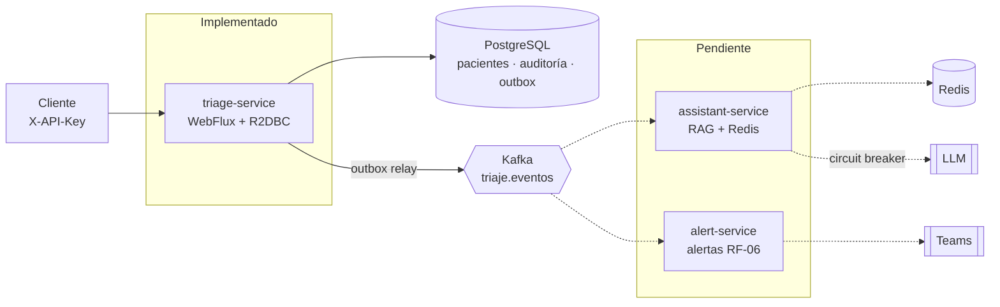

# VidaCruz — Sistema de Triaje Digital

Backend reactivo (Java 21, Spring Boot 3.5, WebFlux, R2DBC, Kafka) para el triaje de urgencias de VidaCruz: registra pacientes, los clasifica con reglas clínicas objetivas, controla los tiempos de atención (SLA), escala automáticamente a quienes los superan y deja auditoría clínica completa. Un segundo servicio ofrece un asistente clínico con RAG que solo responde con contenido de los protocolos oficiales.

> Prueba técnica "Dev. WebFlux" (nivel Senior / Arquitecto). El enunciado está en [`docs/enunciado-prueba.md`](docs/enunciado-prueba.md) y la especificación completa en [`docs/especificacion.md`](docs/especificacion.md).

## Estado

| Requisito | Descripción | Estado |
|-----------|-------------|--------|
| RF-01 | Registro y clasificación automática (`POST /triage/pacientes`) | Implementado |
| RF-02 | Flujo de estados y consulta (`PATCH .../estado`, `GET .../{id}`) | Implementado |
| RF-03 | Monitoreo de SLA y escalamiento automático | Implementado |
| RF-05 | Reporte de operación por hora (SQL avanzado, [ADR-0011](docs/adr/0011-reporte-operacion-rf05.md)) | Implementado; `ReporteOperacionIT` pendiente de ejecutar con Docker |
| RF-04 | Asistente clínico con RAG y estado de urgencias en tiempo real | Pendiente (`assistant-service`) |
| RF-06 | Alertas de escalamiento al equipo médico | Pendiente (`alert-service`) |
| — | Manifests de Kubernetes / despliegue en Azure | Pendiente |

Hoy el repositorio contiene `triage-service` y el módulo `events-contract`. Los otros dos servicios están diseñados en los [ADR](docs/adr/README.md) y aún no tienen código. El `docker-compose.yml` ya los declara, por lo que solo `triage-service` y su infraestructura se pueden levantar por ahora.

## Requisitos

- Java 21
- Docker (para ejecutar el sistema y las pruebas de integración con Testcontainers)
- Maven Wrapper en la raíz (`mvnw` y `.mvn/`). Si no están, genéralos una vez con `mvn -N wrapper:wrapper`; el `Dockerfile` los necesita.

## Ejecución local

```bash
cp .env.example .env          # completa DB_PASSWORD y API_KEY
docker compose -f deploy/docker/docker-compose.yml --env-file .env up --build \
  postgres kafka kafka-init redis triage-service
```

Cuando existan los tres servicios, el comando de un solo paso será el mismo sin indicar servicios.

Levanta PostgreSQL, Kafka (modo KRaft), la creación de los topics, Redis y `triage-service` en `http://localhost:8081`. Flyway crea el esquema al arrancar.

### Variables de entorno

| Variable | Obligatoria | Descripción |
|----------|:-----------:|-------------|
| `DB_PASSWORD` | Sí | Contraseña de PostgreSQL |
| `DB_USER` | No | Usuario de PostgreSQL (por defecto `triage`) |
| `API_KEY` | Sí | Clave que deben enviar los clientes en `X-API-Key` |
| `TRIAGE_SLA_EVALUATION_INTERVAL` | No | Cada cuánto evalúa el monitor de SLA (por defecto `30s`) |
| `TRIAGE_SLA_MONITOR_ENABLED` | No | `false` apaga el scheduler (por defecto `true`) |
| `LLM_API_KEY` | Con el asistente | Clave del proveedor de LLM. Nunca se versiona |
| `TEAMS_WEBHOOK_URL` | Con alertas | Webhook de Teams. Vacío: solo registro en log |

Los SLA por nivel están en `services/triage-service/src/main/resources/application.yml` (`triage.sla.minutos`).

## Probar la API

Todos los endpoints exigen `X-API-Key`, salvo los probes `/actuator/health/**`.

```bash
export API_KEY=la-clave-de-tu-.env

# RF-01: paciente de ejemplo E1 → nivel CRITICO, SLA de 5 minutos
curl -s -X POST http://localhost:8081/triage/pacientes \
  -H "X-API-Key: $API_KEY" -H "Content-Type: application/json" \
  -d '{"nombreCompleto":"Carlos Gómez","edad":55,"frecuenciaCardiaca":130,
       "presionSistolica":180,"presionDiastolica":110,"spo2":97,
       "temperatura":36.8,"dolor":8,"gcs":15,"quejaPrincipal":"Dolor torácico"}'

# RF-02: pasar a consulta (200) y consultar el paciente
curl -s -X PATCH http://localhost:8081/triage/pacientes/<id>/estado \
  -H "X-API-Key: $API_KEY" -H "Content-Type: application/json" -d '{"estado":"EN_CONSULTA"}'
curl -s http://localhost:8081/triage/pacientes/<id> -H "X-API-Key: $API_KEY"
```

Respuestas de error en formato RFC 7807: `400` (dato fuera de rango, indica el campo), `401` (sin clave), `404` (paciente inexistente) y `409` (transición inválida, por ejemplo `ALTA → EN_CONSULTA`).

### Ver el escalamiento (RF-03) sin esperar

Con el intervalo en `5s` en el `.env`, retrasa el registro de un paciente en la base de datos:

```bash
docker compose -f deploy/docker/docker-compose.yml exec postgres psql -U triage -d triage \
  -c "UPDATE pacientes SET fecha_registro = now() - interval '1 hour' WHERE id = '<id>';"
```

En el siguiente ciclo, `GET /triage/pacientes/<id>` devuelve `flags.escalado: true`, queda una fila `PACIENTE_ESCALADO` en `auditoria_clinica` y se publica `paciente_escalado` en `triaje.eventos`. Para ver los eventos:

```bash
docker compose -f deploy/docker/docker-compose.yml exec kafka /opt/kafka/bin/kafka-console-consumer.sh \
  --bootstrap-server kafka:9092 --topic triaje.eventos --from-beginning
```

## Pruebas

```bash
./mvnw test      # unitarias y de arquitectura (no requieren Docker)
./mvnw verify    # además las de integración *IT (requieren Docker)
```

| Tipo | Qué cubre |
|------|-----------|
| Dominio | Clasificación de E1–E6 y valores límite, invariantes de signos vitales, matriz de transiciones, regla de SLA |
| Aplicación | Casos de uso con puertos simulados: registro, cambio de estado (409, 404, concurrencia), escalamiento (rollback si falla el outbox) |
| Infraestructura | Validación de la entrada, mappers, contrato JSON del evento, política de SLA, scheduler con tiempo virtual |
| Arquitectura | ArchUnit: el dominio no depende de Spring ni de infraestructura; los adaptadores no se conocen entre sí |
| Integración | Flujos completos contra PostgreSQL y Kafka reales: registro, estados, escalamiento idempotente y concurrente, scheduler |

## Arquitectura



Cada servicio sigue arquitectura hexagonal (`domain` ← `application` ← `infrastructure`), con las reglas verificadas por ArchUnit. El triaje no depende del asistente ni de las alertas: solo publica eventos.

```text
vidacruz-triage-platform/
├── contracts/events-contract/      # Contrato de eventos compartido (sin lógica)
├── services/triage-service/
│   └── src/main/java/com/vidacruz/triage/
│       ├── domain/                 # Modelo, invariantes y reglas (sin frameworks)
│       ├── application/            # Casos de uso (port.in) y puertos de salida (port.out)
│       └── infrastructure/         # REST, scheduler, R2DBC, outbox/Kafka, seguridad, métricas
├── deploy/docker/                  # docker-compose.yml y Dockerfile genérico
└── docs/                           # Enunciado, especificación y ADR
```

## Decisiones clave

Documentadas como ADR en [`docs/adr/`](docs/adr/README.md). Las que ya están en código:

- **Transactional Outbox (ADR-0003):** paciente, auditoría y evento se escriben en una sola transacción; un relay reactivo publica a Kafka con entrega at-least-once. Los consumidores deduplican por `eventId`.
- **Escalamiento atómico (ADR-0004):** un único `UPDATE ... RETURNING` con `FOR UPDATE SKIP LOCKED`. La idempotencia (RN-03) la garantiza la condición del `WHERE`, también con varias réplicas.
- **Control optimista de estados:** el `UPDATE` incluye el estado esperado en el `WHERE`; un cambio concurrente responde 409 sin auditar ni publicar.
- **Auditoría inmutable (RN-04):** tabla append-only con un trigger que rechaza `UPDATE` y `DELETE`; no existe endpoint de borrado.
- **API key (ADR-0008):** `X-API-Key` comparada en tiempo constante, sin credenciales en el código.
- **Spring Boot 3.5 (ADR-0010):** exigido por el enunciado, aunque ya no recibe parches de código abierto. El riesgo y la migración a Boot 4 están documentados.

## Limitaciones conocidas

- El `correlationId` viaja por el Reactor Context y se guarda en la auditoría y en los eventos, pero todavía no se propaga al MDC de los logs.
- La tabla `outbox_events` crece: falta una política de limpieza de eventos ya publicados.
- `/actuator/prometheus` exige la API key; hay que configurar el scrape en el despliegue.
- El código se escribió sin acceso a Maven Central ni Docker. Antes de entregar, ejecuta `./mvnw verify` y corrige los ajustes menores de compilación que aparezcan.